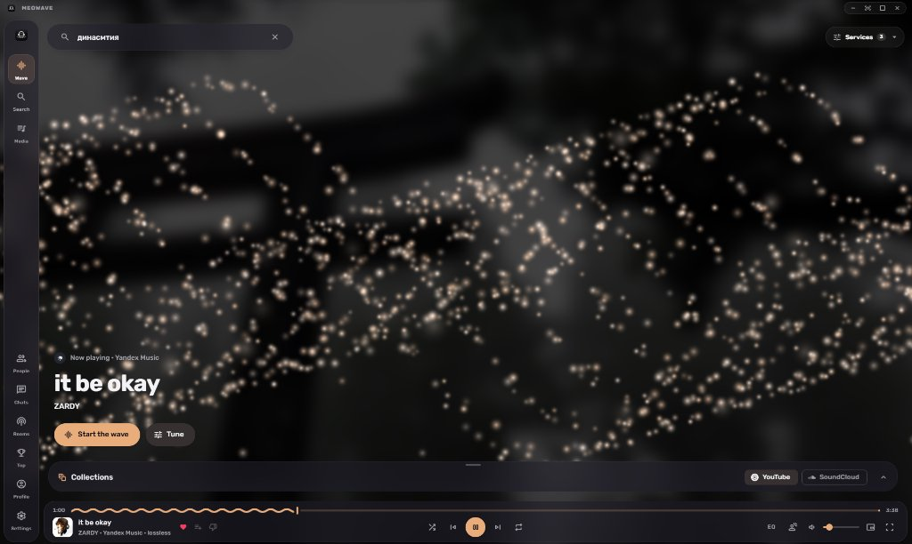
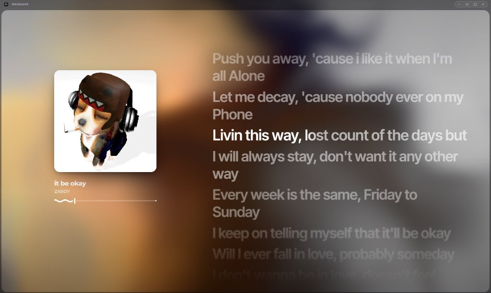
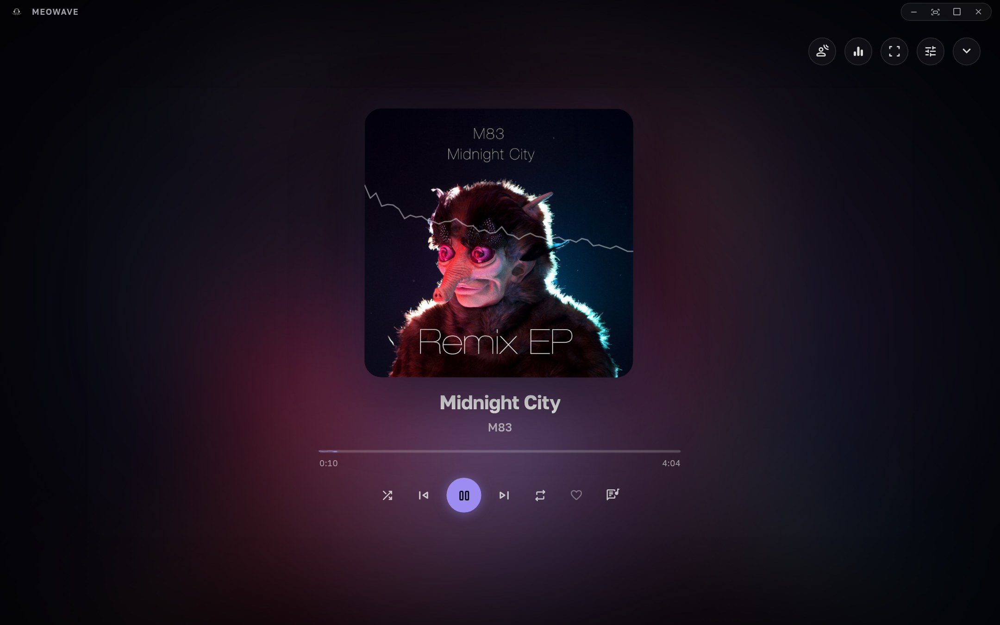
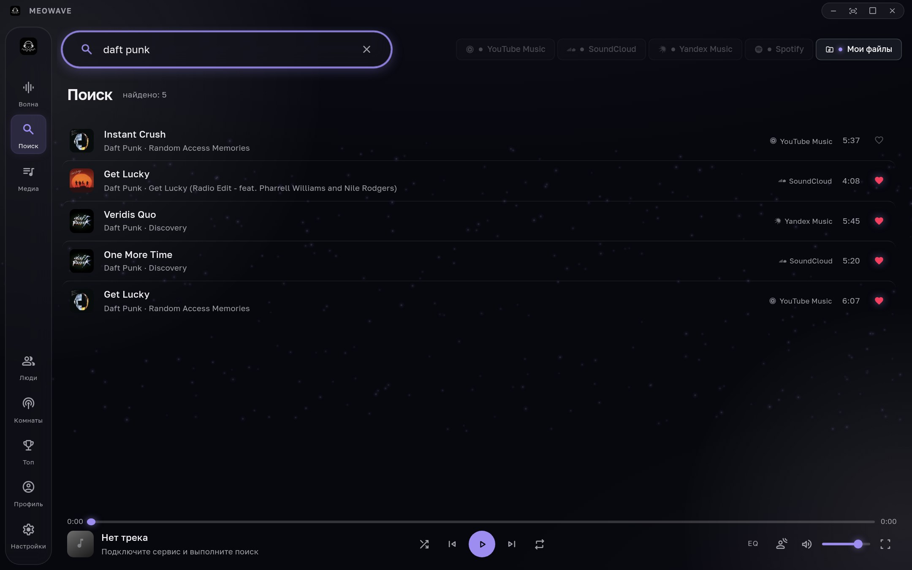
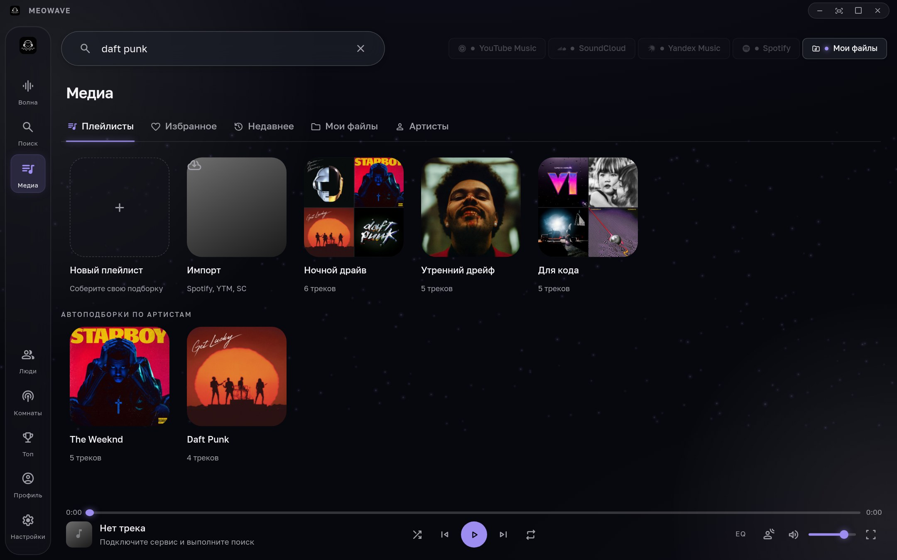
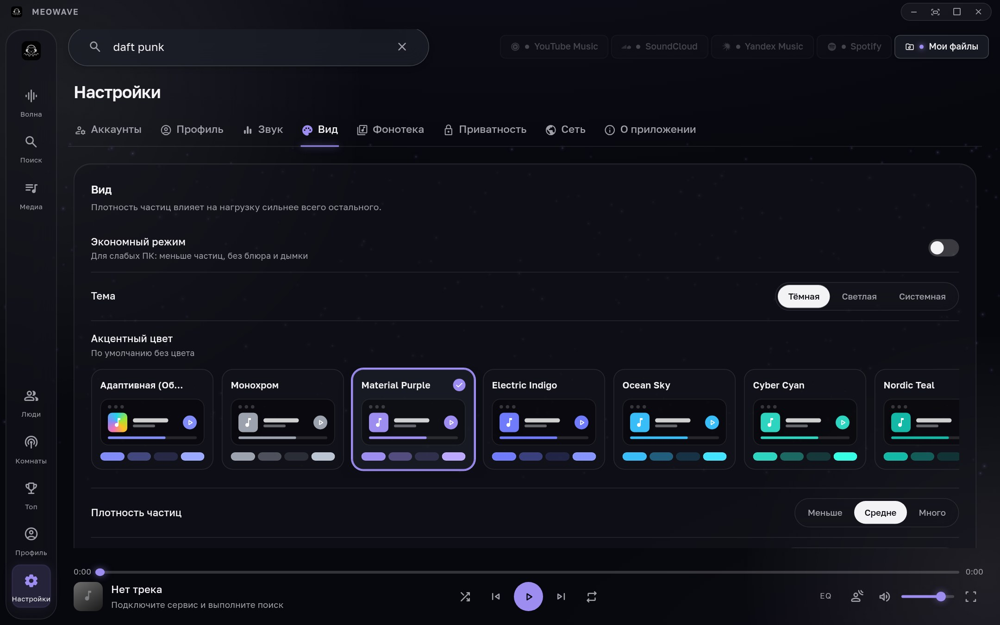
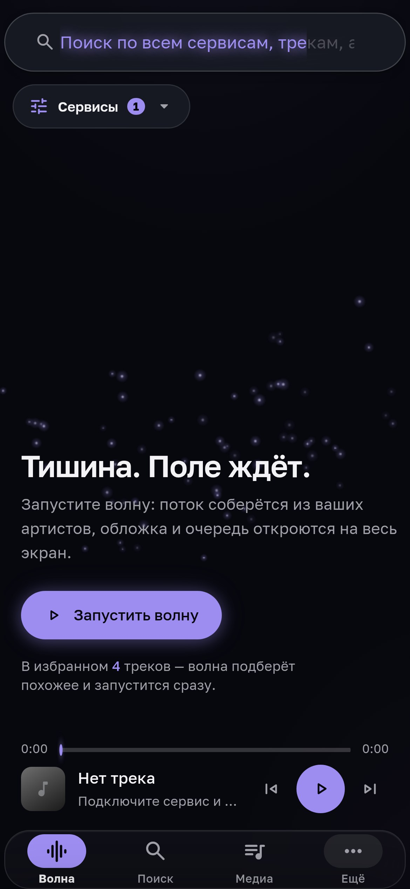
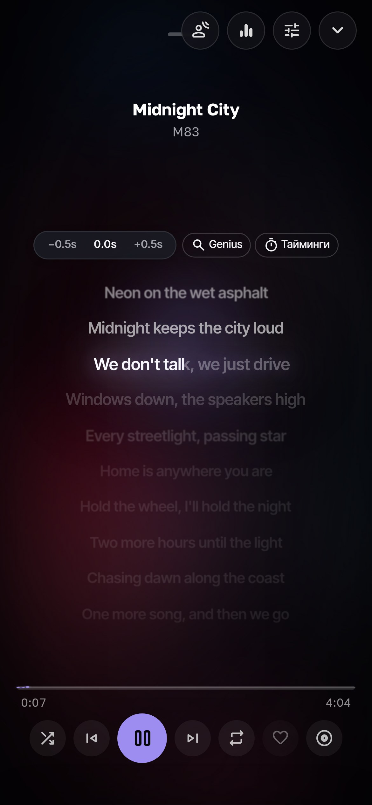

# Meowave

> High-fidelity, ultra-lightweight multi-service desktop music player for Windows, Linux, and macOS.
> Built with Tauri 2, Rust, Vite, TypeScript, and Google Material You Expressive design tokens.

[](https://kotar1223.github.io/meowave/)
[](https://github.com/kotar1223/meowave/releases/latest)
[](https://tauri.app)
[](https://m3.material.io/)
[](https://www.typescriptlang.org/)
[](LICENSE)

---

## Overview

Meowave brings SoundCloud, Yandex Music, YouTube Music, Spotify, Apple Music catalogs, and local files into a single unified queue and search engine. Unlike resource-heavy Electron players, Meowave is powered by Rust and Tauri 2, consuming under 15 MB of RAM in background playback while offering an audiophile-grade DSP chain, real-time synchronized karaoke lyrics, and an adaptive Material You interface.

```
+-------------------------------------------------------------------------------+
|                                  MEOWAVE UI                                   |
|               (Vite + TypeScript + Material You M3 Expressive)                |
+-------------------------------------------------------------------------------+
       |                                                    |
       v                                                    v
+-----------------------------+              +----------------------------------+
|      RUST NATIVE ENGINE     |              |       WEBVIEW AUDIO ENGINE       |
|    (Default Desktop Path)   |              |         (Fallback Path)          |
|  - Symphonia Audio Decoders |              |  - Web Audio Context Graph       |
|  - 10-Band Graphic EQ       |              |  - HRTF 3D PannerNode (Binaural) |
|  - CPAL Hardware Output     |              |  - Opus, HE-AAC, Blob Formats    |
+-----------------------------+              +----------------------------------+
       |                                                    |
       +----------------------------+-----------------------+
                                    |
                                    v
                     +------------------------------+
                     |   LOCAL STREAMING PROXY      |
                     |  (127.0.0.1:port/stream/)    |
                     |  - Token & DNS Rebind Guard  |
                     |  - Rate-Limited Media Buffer |
                     +------------------------------+
```

---

## Interface Gallery

### Main Screen & Ambient Particle Field
Interactive particle field responding dynamically to musical beats, queue events, and album palette shifts.

<p align="center">
  
</p>

---

### Fullscreen Player & Synced Karaoke Lyrics
Real-time line-by-line synchronized lyrics powered by LRCLIB and Genius with built-in timing calibrator and focus blur effects.

<p align="center">
  
</p>

---

### Stage Mode & Live Waveform
Alternative visual layout featuring cinematic artwork presentation with animated audio wave ribbons.

<p align="center">
  
</p>

---

### Unified Multi-Service Search
Instant cross-service queries returning tracks, artists, albums, and playlists from YouTube Music, SoundCloud, and Yandex Music in a single list.

<p align="center">
  
</p>

---

### Media Library & Local Audio
Playlists, favorites, listening history, and local audio files (FLAC, MP3, WAV, AAC, OGG) unified under one roof.

<p align="center">
  
</p>

---

### Material You & Sound Settings
29 tonal color roles derived dynamically from artwork, with full control over audio engines, DSP filters, and appearance.

<p align="center">
  
</p>

---

### Responsive & Mobile Adaptations
Full-featured touch navigation, 100dvh viewport compliance, and gesture controls for mobile viewports.

<p align="center">
  
  &nbsp;
  
</p>

---

## Material You Expressive Design

Meowave implements Google's **Material Design 3 (Material You) Expressive** specifications. Instead of static themes, the interface dynamically generates 29 tonal color roles in the OKLCH color space directly from the dominant tones of the active track's album art.

### Dynamic Tonal Swatches

```
+-------------------------------------------------------------------------------------------------------+
|  Tone 95     |  Tone 90     |  Tone 80     |  Tone 70     |  Tone 50     |  Tone 30     |  Tone 10    |
|  Surface     |  Container   |  Accent Soft |  Secondary   |  Primary M3  |  Surface Dim |  Base Dark  |
|  #F5EDFF     |  #EAD7FF     |  #D0A7FF     |  #B87AFF     |  #9A46FF     |  #4A1282     |  #1A0038    |
+-------------------------------------------------------------------------------------------------------+
```

### Material 3 Architecture Tokens

- **Dynamic Contrast Roles:** Guaranteed WCAG AAA compliance between `onPrimary`, container surfaces, and background cards.
- **Concentric Corner Radii:** Geometric nesting where inner elements match outer card curvature formulas (`R_inner = R_outer - padding`).
- **Surface Elevation Containers:** 5-step elevation layering using `surfaceContainerLowest` through `surfaceContainerHighest` without noisy drop shadows.
- **Adaptive Ambient Wave:** Subtle background glow matching the album art hue, rendered with GPU-accelerated canvas particles at 30/60 fps.
- **Custom Accent Engine:** Built-in palette selector providing soft pastels, monochrome, or custom seed color HEX inputs with instant re-theming.

---

## Core Capabilities

### Unified Streaming & Local Audio
- **Multi-Service Catalog:** SoundCloud, Yandex Music, YouTube Music, Spotify, Apple Music, and local storage.
- **No API Keys Required:** Anonymous catalogs and stream resolution out of the box.
- **Offline Storage:** Download tracks to disk with zero DRM locks. Local files are played directly from storage without cloud roundtrips.

### Dual Audio Architecture
- **Native Rust Audio Engine (Default):** Read-ahead buffering, Symphonia multi-format decoding (MP3, AAC, FLAC, ALAC, Vorbis, WAV), hardware-synced 10-band equalizer, and CPAL audio endpoint delivery. Eliminates WebView dropouts and audio glitches.
- **Web Audio Engine (Fallback):** Web Audio context graph powering Opus, HE-AAC, blob media, and mobile environments.

### Audiophile DSP Suite
- **10-Band Graphic Equalizer:** Custom frequency curves with per-track and per-playlist preset assignment.
- **3D Spatial Audio:** HRTF binaural head-orbit panner with customizable orbit radius, rotation frequency, and height elevation.
- **Nightcore & Slowed+Reverb:** Continuous speed shifting from 0.5x to 1.5x with pitch coupling and ConvolverNode room reverberation.
- **Smart Loudness Management:** Clean peak limiter offering up to +9 dB loudness boost and track-to-track volume normalization.

### Native System Integration
- **Windows 11 Thumbnail Toolbar:** Play, pause, and skip tracks straight from the taskbar thumbnail preview (`ITaskbarList3`), matching Spotify behavior.
- **Linux Desktop & MPRIS:** Full integration with D-Bus MPRIS (`playerctl`), desktop media keys, and system sound panels.
- **Discord Rich Presence:** Displays current track, album art, elapsed time, and service origin on your Discord profile.

### Social Layer & Listening Rooms
- **Synchronized Listening Rooms:** Real-time host-synchronized playback with shared queues, guest request voting, and room chat.
- **End-to-End Encrypted Messenger:** Direct messaging with P-256 ECDH key exchange and AES-GCM payload encryption. Supports quoted replies, track sharing, images, and delivery receipts.
- **Quasar ID Profiles:** Customizable profile with bio, pinned track, and up to three displayable achievement badges.

---

## Service Matrix

| Service | Audio Playback | Search & Catalog | Authentication | Notes |
| :--- | :--- | :--- | :--- | :--- |
| **SoundCloud** | Supported | Supported | Anonymous / OAuth | Direct streaming through local proxy |
| **Yandex Music** | Supported | Supported | OAuth Sign-in / Token | High-quality HQ audio streams |
| **Local Files** | Supported | Supported | None | FLAC, MP3, WAV, AAC, OGG from local drive |
| **Spotify** | Matched Stream | Supported | Anonymous / PKCE OAuth | Matched against lossless/clean providers |
| **Apple Music** | Matched Stream | Supported | None | Public iTunes & RSS catalog search |
| **YouTube Music** | Supported | Supported | InnerTube Guest | Full track catalog resolution |

*Note on Spotify and Apple Music:* Audio streams from Spotify and Apple Music are protected by DRM and cannot be played directly by third-party desktop players. Meowave matches track metadata against clean audio providers to play the exact recording seamlessly.

---

## Security & Privacy Invariants

- **Zero Telemetry:** No user activity tracking, analytics pings, or marketing SDKs.
- **Local Secret Storage:** Service credentials and authentication tokens are stored exclusively in the OS native credential store (Windows Credential Manager / macOS Keychain / Secret Service API).
- **Strict Network Proxy:** All audio and image streams pass through a hardened local loopback proxy (`127.0.0.1:port/stream/?k=...`) protected by ephemeral session keys to prevent DNS rebinding and timing attacks.
- **Row-Level Security (RLS):** All backend interactions with Postgres are enforced by database-level security policies; stats and badges are verifiable only via security-definer procedures.

---

## Installation & Updates

### Download Releases
Official standalone installers and portable builds are published on GitHub Releases:
- **Repository:** [https://github.com/kotar1223/meowave](https://github.com/kotar1223/meowave)
- **Latest Release:** [https://github.com/kotar1223/meowave/releases/latest](https://github.com/kotar1223/meowave/releases/latest)

### Automatic In-App Updates
- **Installed Builds:** The app periodically queries the release endpoint for signed update bundles verified via Minisign public key signatures.
- **Source Checkouts (`npm run dev`):** The application detects local git repository checkout state and provides one-click `git pull` updates directly from the settings dialog.

---

## Development & Building

### Prerequisites
- [Rust](https://www.rust-lang.org/tools/install) (latest stable) and Cargo
- [Node.js](https://nodejs.org/) 20.19+ or 22.12+ (npm 10+)
- [Tauri Prerequisites](https://tauri.app/start/prerequisites/) for your operating system

Linux users require GStreamer development packages:
```bash
# Debian / Ubuntu
sudo apt install libwebkit2gtk-4.1-dev libappindicator3-dev librsvg2-dev patchelf \
  libgstreamer1.0-dev libgstreamer-plugins-base1.0-dev libgstreamer-plugins-bad1.0-dev
```

### Running Locally

```bash
# Clone the repository
git clone https://github.com/kotar1223/meowave.git
cd meowave

# Optional: configure local environment overrides
cp .env.example .env

# Start desktop development mode (auto-installs dependencies and launches Tauri)
npm run dev

# Start frontend development server in browser only
npm run web
```

### Building Release Bundles

```bash
# Fetch bundled FFmpeg sidecar (verified with official publisher checksum)
npm run ffmpeg

# Build optimized production bundle
npm run build
```

Production installers will be located in:
`src-tauri/target/release/bundle/`

### Test & Verification Commands

```bash
# Run complete verification suite (build, Rust clippy, cargo tests)
npm run check

# Check frontend JavaScript syntax and TypeScript types
npm run check:js
npm run typecheck

# Run end-to-end automated smoke tests
npm run test:e2e
```

---

## Project Structure

```
meowave/
|-- brain/               # Developer second brain (Obsidian vault: architecture, logs, specs)
|-- docs/                # GitHub Pages showcase site & promo assets
|   |-- assets/promo/    # High-resolution application screenshots and demo clip
|-- scripts/             # Build scripts (web bundler, FFmpeg downloader, schema generator)
|-- src/                 # Application frontend root
|   |-- app.js           # Core player state machine and UI logic
|   |-- app.css          # Design system styles and Material You custom properties
|   |-- index.html       # Application DOM layout and overlays
|   +-- ts/              # TypeScript modules (naudio, discover, search, messenger, aura)
|-- src-tauri/           # Native Rust backend
|   |-- src/audio/       # Native Symphonia decoder, DSP pipeline, and CPAL output
|   |-- src/stream.rs    # Local streaming proxy and media resolver
|   |-- src/update.rs    # Dual update engine (signed releases & git pull)
|   +-- Cargo.toml       # Rust crate dependencies
+-- supabase/            # Database schemas, migrations, and achievement definitions
```

---

## License & Credits

- **Author:** [kotar1223](https://github.com/kotar1223)
- **Telegram Channel:** [@meowaveplayer](https://t.me/meowaveplayer)
- **Developer Chat:** [@techupdate_chat](https://t.me/techupdate_chat)
- **Third-Party Libraries:** Built with [Tauri](https://tauri.app), [Symphonia](https://github.com/pdeljanov/Symphonia), [cpal](https://github.com/RustAudio/cpal), and [Vite](https://vite.dev).
- **FFmpeg:** Distributed under LGPL v3 as a sidecar binary. See `FFMPEG-LICENSE.txt` for details.
- **License:** MIT License. See [LICENSE](LICENSE) for details.
